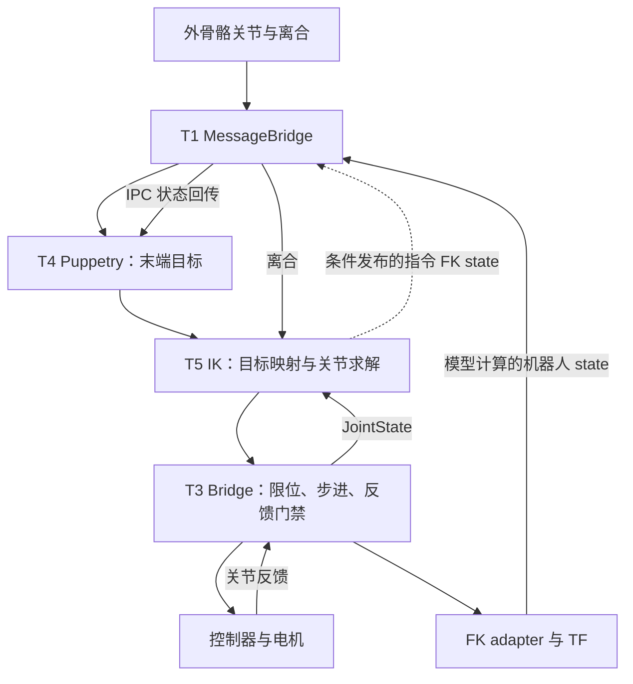

# 外骨骼适配 FAQ 与故障排查指南

> 版本：v1.0，2026-11-09。依据：本仓库 `44d6192` 的源码、任务台账和历史记录。
> 适用：外骨骼 → 末端目标 → 机器人 IK → Bridge → 控制器的遥操作适配；命令示例针对 DM-EXton2 / ROS 2 Humble。
> 本文是诊断与交付参考，不是现场运动授权。任务当前状态以 [TASKS.md](../TASKS.md) 为准，后续版本可能改变部署状态。

## 阅读导航

| 你正在做什么 | 从哪里开始 |
|---|---|
| 第一次接入外骨骼或换机器人 | [适配阶段与交付物](#stages) → [接口契约](#contracts) |
| 现场已有故障，想快速定位 | [症状速查](#symptoms) → 对应故障卡 D01～D12 |
| 手臂自己动、突跳或方向反 | [D05～D08](#d05)，先区分目标、指令和实际反馈 |
| 需要检查命令 | [只读取证命令](#commands)，先确认运行环境与命令权限 |
| 想知道原理、工具边界与常见误区 | [FAQ：F01～F30](#faq) |
| 准备交付或找厂家支持 | [验收清单](#acceptance) → [证据与报修模板](#evidence) |

<a id="boundaries"></a>
## 1. 使用边界与证据规则

### 1.1 先区分四种操作

| 类别 | 例子 | 使用条件 |
|---|---|---|
| 纯离线 | 读源码、解析 URDF、分析历史包、运行 mock 测试 | 不连接机器人；候选模型与生产模型分开 |
| ROS 只读 | 查询节点、参数、话题、读取日志 | 在获准现场主机上使用实际 ROS 环境；不发布、不改参数、不重启 |
| 控制器只读 | 查询状态、配置、关节与 TCP | 仍会建立控制器连接；须事先协调 TCP 独占和现有客户端，不能随手并接 |
| 改变现场状态 | 部署、重启、切换参数、使能、清故障、摆位、运动 | 按任务与现场批准范围实施；只读排查不能自动升级为这些操作 |

异常运动、堵转、碰撞风险、反馈失效、控制权冲突出现时：停止派发新动作，由现场操作员按已验证流程接管；必要时使用现场急停。**松离合、停发命令、控制器停止、机械臂实际停稳是四个不同事件**，必须分别确认。不要用重复重启、反复清故障或持续重发来试探恢复。

本项目保持 `auto_enable=false`。不得把修改 `move_speed`、关闭 watchdog、放宽限位、扩大跟随误差阈值作为默认修复。控制器已 fault 时，不假设再次 `stop_motion` 能恢复；T33 对不可信状态/失败回执停止新命令，记录交由操作员处理。

### 1.2 每条结论标明证据层级

- **源码确认**：当前代码具有某行为；仍需确认现场实际运行的是该版本。
- **离线验证**：测试/回放能复现；不能据此声明真机已验收。
- **历史实测**：有日期、包名、日志或原始响应；不代表今天的设备状态。
- **待验证**：机制推测、候选参数、厂家口径待复核；不得写成已解决。

仓库早期文档存在旧快照：例如把 `program_run_failed` 优先归因于 50Hz 程序重叠、把旧 T30 直接命令当执行入口。后续 T28 有堵转 fault 证据，T30 已并入 T34。发生冲突时回到当前任务卡、协议证据和源码，不照抄历史操作步骤。本文不复制登录密码或设备凭据。

<a id="architecture"></a>
## 2. 先看清链路：问题在哪一层



图中 state 回传的实际发送者和条件必须现场确认。MessageBridge/Puppetry 是厂家组件，内部算法不可仅凭话题名推断。`/ee_poses` 等厂商辅助话题也需核实语义。

| 观测量 | 项目入口 | 能回答什么 | 不能单独证明什么 |
|---|---|---|---|
| 外骨骼关节 | `/exoskeleton/joint_states` | 操作员输入是否传到 ROS、名称和值是否连续 | 末端映射正确、机器人已动作 |
| 离合 | `/clutch/left`、`/clutch/right` | 哪一侧被允许跟随、边沿何时发生 | 控制器实际停稳 |
| 末端目标 | `/target_robot/{side}_ee/target` | Puppetry 输出是否跳变/漂移 | frame、单位与机器人 base 一致 |
| IK 关节指令 | `/target_robot/joint_commands` | 求解器打算让哪些关节变化 | 控制器收到或执行 |
| Bridge 发送/拒绝 | T3 日志的 sent、reject 等 | 命令是否派发、是否被拒绝 | 实际位移和设备反馈活性 |
| 关节反馈 | `/client_robot/joint_states`、控制器原始 joint | 关节数值跟踪与跟随误差 | 单凭 ROS 消息时间戳不能证明设备侧新鲜度；先确认没有指令回填 |
| 模型末端 state | `/target_robot/{side}_ee/state`、TF | 某个 URDF 和关节输入对应的 FK | 独立实测 TCP、URDF 匹配真机 |
| 控制器 TCP | `get_tcp_pose` | 控制器内部运动学给出的 TCP | 独立外部测量真值；还需核对 base、工具和协议 |

按同一时间窗比较：**外骨骼 → target → IK 指令 → 发送/回执 → 实际关节 → TCP**。找出第一处与预期不符的转换，再调查该处。不要用末端一个现象同时修改五个环节。

<a id="stages"></a>
## 3. 一次完整适配应怎样推进

| 阶段 | 要完成的事 | 必须留下的交付物 | 未通过时停在哪里 |
|---|---|---|---|
| S0 资料与权限 | 硬件型号、固件、接口、负载、网络、现场操作分工 | 版本表、控制权清单、停止/恢复负责人 | 不做真机动作 |
| S1 环境与链路 | ROS 域、RMW、节点、话题、时钟、依赖版本 | T31 采集包、实际运行路径与启动日志 | 不把源码默认值当现场值 |
| S2 外骨骼输入 | 佩戴与零位按厂家流程确认；左右、离合、单位、有效范围 | 静止记录、厂家校准记录、离合事件表 | 输入不稳定先查输入链 |
| S3 模型与协议 | URDF 来源、关节名/序/方向/限位、base/TCP、四元数 | G0/G1/G2 检查、当次限位快照 | 不接生产运动链 |
| S4 物理方向验证 | 经批准的单关节五点试采；逐轴验证、回位检查 | T34 目标/实际 q、TCP、时戳、两次回位误差 | 异常即止，不扩范围 |
| S5 坐标转换 | 定义唯一可逆的关节转换与非对称限位映射 | T35 数学契约、round-trip 与隔离回归 | 不叠加 URDF/Bridge 多重取反 |
| S6 末端标定 | 平移六方向，之后才是姿态换基与比例 | T36/T37 候选 JSON、独立验证包、误差表 | 不用训练包替代独立验收 |
| S7 稳定与性能 | 起流、手静、释放、重按、单臂/双臂、时延 | 场景矩阵、录包、延迟和拒绝统计 | 不只凭主观“更顺”放行 |
| S8 冻结与交接 | 生产副本一致、回退可用、资料齐备 | hash、配置、版本、验收报告与回退步骤 | 未部署/未验证明确列出 |

S3～S6 可能需要迭代：控制器字段或 frame 不清先补证据。未验收模型可在明确隔离、`NOT_FOR_ROBOT` 的离线 IK/RViz 环境预演；禁止把候选直接替换生产模型。生产模型的 G0～G4 门禁见 [URDF 真机验收方案](./URDF真机验收方案.md)。

**当前项目边界（编写基线）**：T32/T33/T39 离线交付已合并；T31 现场证据仍待采集，T34 未获本轮现场执行资格，T35 及后续生产修正保持冻结。PR #14 批量采数入口有已复现阻断项，不能替代 T33/T34。

<a id="contracts"></a>
## 4. 接口契约：适配前先填这张表

每个字段要有“定义、证据来源、是否现场确认”，缺失记 `未验证`，不要靠左右镜像或变量名猜。

| 项目 | 必须明确的内容 | 本项目核对提示 |
|---|---|---|
| 关节 | 名称、顺序、轴数、单位、零位、正方向 | ROS JointState 按 name 对应，不能按数组裸切片假设左右顺序 |
| 控制器 joint | 完整槽位、未动轴保持策略、缺失/非法值行为 | 协议 17 维：腰、左 7、右 7、头 2；不是外骨骼 12 维或 ROS 常见 14 维 |
| TCP | left/right 段、单位、四元数顺序、工具定义 | 协议 pose[14] 左 7 + 右 7；每段 xyz + qw,qx,qy,qz；现场固件仍需原始响应核对 |
| ROS 姿态 | Quaternion 分量顺序、坐标变换方向 | ROS 为 x,y,z,w；不能把协议 qw-first 原样塞入 |
| 参考帧 | exo、target、URDF base、控制器 base 的关系 | 当前 IK 不按 target.frame_id 自动查 TF；改字符串不等于做变换 |
| 末端帧 | 法兰、Link7/Link7L、工具 TCP 的区别 | 工具偏移 0.145m 是历史资料/比较假设，方向与生效配置需核实 |
| 时钟 | 设备采样、发送、接收、ROS 发布的时间来源 | 主机接收/发布时间不等于设备采样时间；记录 use_sim_time 与跨机时钟 |
| 状态 | state、错误码、错误数组、完整性、未知值行为 | idle/ready 不足以证明无故障，也不足以证明已使能 |
| 回执 | 收到、排队、受理、开始、完成的具体含义 | 不用 `program_run_finish` 字面名推断整台机器人完成运动 |
| 限位 | 当前软限位、模型限位、安全余量、换系方式 | 当前 get_config 为核对依据，URDF 可按批准余量内缩 |
| 停止 | 松离合、停发、取消队列、控制器停止、急停 | 谁触发、超时怎么判、反馈失效谁接管，都要有现场验证 |

四元数必须检查长度、有限值、非零模长及符合协议的模长范围；不把零四元数静默变为单位姿态。向量里有 NaN/Inf、维度错误、缺失状态或未知响应时，中止运动入口并保留原文。

<a id="symptoms"></a>
## 5. 症状速查：先做哪一个区分

| 症状 | 第一项检查 | 分流依据 | 故障卡 |
|---|---|---|---|
| ROS 节点/话题看不到 | 实际 ROS 域、环境、节点名、QoS | 所有话题都无，还是单个话题无 | D01 |
| 外骨骼输入跳或漂 | 外骨骼关节与离合同窗记录 | 原始输入已变，还是 target 才开始变 | D02 |
| 按离合不跟手 | 离合、target、commands、sent 逐级看 | 第一处停止变化的位置 | D03 |
| sent 增长、真机不动 | 状态原文、拒绝、实际反馈 | fault/未使能/反馈失活/回执语义 | D04 |
| 手静但机器人继续动 | target、q_cmd、q_fb 谁先变 | 上游漂移、IK 残差、Bridge 纠偏分别处理 | D05 |
| 一按就跳、松开重按又跳 | 离合边沿前后旧目标/滤波/锚点 | 断档恢复还是双臂交叠触发 | D06 |
| 左右、前后、旋转方向不对 | frame 契约与单轴实测 | 输入映射、关节约定、模型结构三层分开 | D07 |
| RViz 正确、实机姿态很离谱 | 同 q 的模型 FK 与控制器 TCP | TF 自洽还是物理匹配 | D08 |
| 关节抖、走停、明显滞后 | 各级时序、误差、回执间隔 | 求解超时、发送节拍、执行迟滞 | D09 |
| 单臂正常、双臂异常 | 交叠离合与每臂 reset/耗时 | 共享状态重置、预算、控制器耦合 | D10 |
| 改了参数或文件没效果 | 进程实际路径、启动日志、hash | 初始化缓存、文件优先级、改错副本 | D11 |
| 重启后端口关/数据冻结 | 监听、设备状态、CAN 统计 | 服务未起还是电机执行层失活 | D12 |

<a id="diagnostics"></a>
## 6. 故障卡：检查 → 处理 → 复验

### D01：节点或话题缺失

**检查**：先确认当前终端 source 了正确 ROS 与工作区，实际进程的 `ROS_DOMAIN_ID`、`ROS_LOCALHOST_ONLY`、RMW 与观察端是否匹配。然后读 node list、topic info 的端点、类型与 QoS。目标话题在离合释放时可能本来就不发布；短窗口无样本不是进程已死的证据。

**处理**：修正观察端环境或配置文件中的接线错误；节点命名空间不同就按实际全名查询。跨主机发现问题再检查局域网、DDS 发现和组播策略。仅在证据指向 QoS 不兼容时调整订阅观察方式，不能为“有数据”而随意改生产发布端 QoS。

**复验**：每个必需话题保存类型、发布者、一个样本和带窗口长度的接收率。ROS 图有节点但无消息时继续查该节点输入与发布条件，不以节点数判成功。见 [T31 审计](./T31运行态与坐标系审计.md)。

### D02：外骨骼输入不稳定、关节/离合异常

**检查**：在无机器人运动的观察条件下记录外骨骼 name/position、离合、target。确认佩戴尺寸、左右绑定、连接器、供电及校准状态均按厂家要求完成；对照设备自身界面与 ROS 输出。静止漂移要报窗口、范围、速度，不能只说“在抖”。

**处理**：若设备侧原始值已异常，转厂家硬件/校准流程；若设备侧稳定而 ROS 异常，查 MessageBridge 的映射、单位、丢包/重复帧。不要先用很大死区滤掉异常，也不要把外骨骼零位校准同时当作机器人零位校准。

**复验**：静置、厂家允许的单轴输入、左右离合分别验证，区分瞬时电平与锁存状态。佩戴/校准改变前后保留两份记录；本仓库没有充分证据规定通用穿戴尺寸和校准动作，需使用对应硬件手册。

### D03：按离合不跟手

依次回答以下五问，第一处“否”就是下一项排查入口：

1. ROS 是否确实看到该侧离合事件？没有则回 D01/D02。
2. Puppetry 是否发布该侧新 target？没有则查输入、IPC、state 来源和厂商配置。
3. IK 是否结束安定等待、目标有效且产生变化的关节指令？没有则查锚点、手静判断、限位、求解异常。
4. Bridge 是否收到 commands，且存在本应发送的非零变化？没有则查订阅/name 映射与门禁原因；`cmd_rx>0` 与 `sent>0` 要分开。
5. sent/回执之后，实际关节与 TCP 是否相应变化？没有则转 D04，不能继续责怪 target。

**复验**：先记录无离合基线，再只在批准的运动窗口验证。无离合时 `sent=0,reject=0` 只说明没派发，不能证明跟手成功。输入起流后短暂安定等待是当前设计的一部分；历史约 0.5～1s 不能当所有版本的固定时延指标。

### D04：命令被拒绝，或“成功”但机器人不动

**检查顺序**：停止追加动作 → 保存完整失败回执 → 核对当前状态原文和实际反馈 → 由操作员确认使能、故障、控制权和现场硬件。

`get_device_state` 需一起检查 `state`、`erroeCode`（厂家原拼写）/兼容别名、`hardwareErrors`、`softwareErrors`、`motorErrorDetails` 与响应完整性。不能只匹配 `idle`。缺字段与未知状态按 T33 拒绝执行，不临时填空值。

**历史区分证据**：T28 有 `state=fault`、硬件错误及堵转明细；另有 `state=idle` 但 `softwareErrors=[34013185]` 的记录。因此“idle 就健康”“拒绝必然是发送太快”均不成立。`motor_id=7` 不自动等于 URDF 第七关节，映射仍需证据。

**处理**：确认是软件接线问题才修接线；确认硬件/故障锁存则由操作员与厂家处置，复发时保留故障前构型、负载和反馈。报文成功但设备不动时，检查 CAN 活性、队列/控制权和是否伪反馈；不要循环 enable/clear_fault 或反复减速重发。

**复验**：状态完整且无故障只是必要条件；还需当次批准、实际位移、停稳与回位反馈。回执语义和停止行为未证实就保持 BLOCKED。协议证据见 [V0.3 梳理](./机械臂通信协议说明_V0.3_梳理.md)。

<a id="d05"></a>
### D05：操作员手静，机器人仍在动

先记录同一手静时间窗的四条曲线：外骨骼输入、target 位姿、q_cmd、q_fb。按最早变化处分流：

| 观察结果 | 优先机制 | 可区分的下一步 |
|---|---|---|
| 外骨骼输入已经漂移 | 输入/校准/佩戴问题 | 对照设备侧读数，回 D02 |
| 输入稳定，target 漂移 | Puppetry 起流/锚定/state 依赖 | 查 state 实际发送者、是否混入指令 FK；记录目标速度 |
| target 稳定，q_cmd 变化 | IK 追赶残余误差，近奇异放大 | 看同窗末端残差、构型、posture/damping、手静冻结是否生效 |
| q_cmd 稳定，Bridge 持续发，q_fb 往返 | Bridge 反馈底步进与物理滞后/过冲耦合 | 看计划基准、发送数、误差符号和拒绝；不先改 IK |
| 上述都稳定，实机仍动或反馈不可信 | 缓存、执行队列、底层控制/硬件 | 操作员接管，核实设备反馈和真实运动 |

**处理**：只选择一条机制做离线回放或经批准单变量实验。T10 有手静冻结的历史修复证据，但 T11 上游滑移与 T12 执行侧自振不能因此一并标已解决。大 damping、很大死区、降低 gain 只能作为有明确判据的候选，不是根因证明。

**复验**：报告手静输入范围、target 位移/姿态速度、关节指令/反馈峰峰值、纠偏帧数及松离合后的实际停止。要同时检查响应是否变钝，不能用“不再动”掩盖失去跟随能力。见 [离合自运动分析](./信号链路与离合自运动分析.md)。

### D06：首次按下、断档重按或切换离合时突跳

**检查**：截取边沿前后数据，标出目标流断档、第一帧 target、滤波状态、锚点 q/p/R 和两臂指令。历史问题包括旧 target 沿用、OneEuro 断档不重置、安定计时基准错误、参考姿态失配，以及任一臂按下重置双臂。

**处理**：核对当前代码是否作废断档前目标、重置滤波、在有效新目标稳定后锚定；对每臂独立保存目标、速度及 posture 锚。输入异常时不应通过缩短等待强行跟随。实际修复在独立分支测试后按批准部署，不现场同时改滤波与关节映射。

**复验场景**：首次按下、短松长按、松开超过断档阈值再按、左右交叠按下、目标暂时中断恢复。分别报第一帧关节跳变、末端跳变、等待时长和非操作臂变化；重按后看起来正常不能代替首次按下验收。

### D07：方向反、轴交换、旋转不符合直觉

**先定位层次**：

1. **输入末端映射层**：外骨骼某方向是否映射到正确 robot base 方向？`mirror_xyz` 只提供同轴翻号，不能表达任意轴交换/旋转。
2. **关节坐标层**：控制器 q 与 URDF q 的顺序、正向、零位是否一致？按 T34 单关节实际反馈 + TCP 与 Jacobian 对照。
3. **模型结构层**：杆长、安装位姿、base/TCP 是否错误？符号表不能修复结构残差。

**处理**：先核实 frame 和方向证据，再按 T35 写唯一转换。不能复制右臂配置给左臂，也不能只看到 CSV 世界轴反向就改 URDF axis。三维映射的姿态换基还需处理旋转轴的伪向量规则，见 F15。

**复验**：关节方向用经批准单轴五点流程；末端映射用 ±X/±Y/±Z 与独立包；姿态逐轴小角度验证。方向、比例、横向泄漏分开报。T34 只产出测量结果，不自动部署修正。见 [专项任务包](./左臂遥操作方向异常_AI任务包.md)。

### D08：RViz 看着对，但真机 TCP 与模型不一致

**检查**：先对齐同一真实 q、同一 base、同一工具帧和时间窗，再比较位置与姿态。检查 m/mm、rad/deg、qw-first/xyzw、左右 TCP 切片、URDF 实际加载路径与摘要。单位四元数等简单离线算例先通过再分析样本。

**处理**：按 G0～G4 检查资料、结构、自洽、真机对账和冻结回归。恒定变换可能提示 base/工具约定，随构型变化的大残差提示链结构/关节约定；两者都只是线索，要跨构型验证，不能在一个位姿凑 TCP 补偿。

**复验**：标准验收至少 20 个去重独立构型，按项目预先声明门限逐样本位置 ≤20mm 且姿态 ≤2°；这是项目门限，不是已证实厂家绝对精度。训练拟合与独立验证分开。T39 的 W/C 对比包含未核实绝对帧假设，CSV 候选不等于新真值。见 [T39 离线结果](./T39_CSV候选URDF离线对比结果_20261108.md)。

### D09：跟手滞后、走停、抖动或求解卡顿

**检查**：测量输入、target、IK 指令、Bridge 下发、实际反馈之间的时序；记录求解耗时分布、超时、CPU 调度、发送间隔、回执延迟、反馈 age 和 reject 增量。250Hz 的循环预算为 4ms，平均耗时低不代表尾延迟合格；主机 CPU 百分比也不是容量验收。

**处理**：先解决 fault、限位和反馈问题，再讨论性能。点到点 movej 与流式 movej_canfd 的语义不同；本项目历史定版基线为 canfd，切换必须作为独立批准实验。不能凭模式名称认定当前拒绝根因，也不能直接提频到 100/200Hz。锁步必须匹配对应运动命令回执，普通查询应答不能解锁。

`step_base=command`、迟滞、按臂 leash 等有离线改进证据，但现场版本和部署状态要核对。计划不再变化不代表机械臂已到位，必须保留实际跟随误差门禁。每次参数 A/B 使用相同构型、负载、动作片段与回退条件。

**复验**：各级中位/P95/最大延迟、有效发送率、反馈实际变化率、拒绝增量、手静纠偏帧、松离合停止行为。见 [Bridge 优化路线](./exton_bridge_对比UBT与优化路线.md)。

### D10：单臂正常，双臂同动或交叠离合异常

**检查**：左右独立记录离合、锚点、last_velocity、posture、计划值与 leash。查一侧按下是否覆盖另一侧 q_commanded；查一侧 FK 让位是否抑制另一侧 state；查求解串行耗时是否超过周期，以及一侧错误是否使整帧冻结。

**处理**：共享状态问题按臂隔离；调度问题先量耗时再决定线程/进程；控制器限制由协议与现场实验确认，不能把软件按臂隔离当作硬件会话已独立。Python 线程不保证重计算并行。

**复验**：左单臂、右单臂、同时按下、左后右、右后左、释放一侧、同侧异常对另一侧影响。按批准范围逐步开展，不能因左臂已测就自动获得右臂或双臂运动许可。见 [左右臂独立计算分析](./左右臂独立计算分析.md)。

### D11：改了参数、标定或代码没有效果

**检查**：确认编辑文件、实际进程启动文件、launch 参数、calib_file、工作区 overlay 与安装副本。记录两端 hash、PID/启动时间和启动日志。参数读回成功不证明初始化时构建的对象已重建。

**本项目特例**：`ArmPoseMap` 在初始化构建，非空标定文件优先于显式矩阵/比例；`publish_commanded_ee_state` 则在控制循环读取。两者不能使用同一“param set 成功即生效”判据。远端 venv/架构与开发机不同，仓库源码也不等于现场部署版本。

**处理**：明确该参数属于热更新还是需重启；按批准方式加载配置，先备份、单文件 diff、再推送；不重建整套环境碰运气。进程重启后重新检查映射和 state 发布策略；当前批准的启动入口以 AGENTS 与现场部署版本为准。

**复验**：启动日志实际 pose_map、calib 文件摘要、行为测试与回退基线同时吻合。不能仅凭文件已保存、Git 已合并或软件无异常退出标已部署。

### D12：上电后服务不起、反馈冻结或 CAN 零应答

**检查**：区分主机可达、控制服务监听、TCP 查询应答、电机实际反馈四层。只读查看服务日志、磁盘空间及经批准取得的 CAN 计数差值；关注 TX 与 RX 是否同时有活性，而不只看累计值或 TX_ERR。

**历史线索**：T25 有磁盘满导致固件服务启动失败；T26 有 CAN TX 持续增长而 RX=0、协议命令“成功”但电机不动。可作为分流签名，不能据此宣称今天也是同一根因。

**处理**：控制器系统/固件由操作员或厂家按批准维护流程处置，本文不提供删除日志、重启固件、断电或清故障的自动命令。冻结时原地重复读取相同关节值无法区分“真静止”和“缓存”，设备序号/时间戳、驱动统计与经批准实际反馈证据需共同核对。

**复验**：服务稳定、反馈语义与活性可核实、硬件故障原因已处理，最后才重新申请动作窗口。反复堵转或失联应升级报修，不能清除错误后直接续跑原轨迹。

<a id="faq"></a>
## 7. FAQ：常见问题与判断方法

### F01：外骨骼适配是不是把两边关节一一对应？

本项目主要采用末端增量遥操：以离合锚定的 exo0/robot0 为基准，将操作员末端位移和姿态增量映射到机器人，再由 IK 求关节。外骨骼 12 维、机器人臂 14 维、控制器 17 维承担不同角色，不能裸复制数组。若换成关节直映射，需重新定义任务与关节契约。

### F02：为什么软件启动成功还不能说适配成功？

进程存活、ROS 收到指令、控制器收到命令、实际完成动作是不同层级。软件链基线至少核对连接、反馈同步、TCP 独占、cmd_rx 和无离合状态；跟手还需要目标有效变化、实际反馈、方向和停稳。`reject=0` 在 `sent=0` 时不能证明运动可执行。

### F03：先调灵敏度还是先对账模型？

先核实状态、反馈、frame、限位和模型，再做映射和灵敏度。把错方向缩小只会使错误不明显。模型与控制器已存在结构性差异时，局部补偿实验必须明确范围，不能宣称全工作空间正确。

### F04：T31 只读审计为什么能阻塞后续任务？

没有实际运行参数与 frame，无法判断 target 的 XYZ/姿态应如何解释，也无法确认 state 是指令 FK 还是测量 FK。源码默认值不能替代运行态。T31 缺证据时保持 BLOCKED，而不是通过写一个假设 frame 解锁运动。

### F05：目标没有消息就是 Puppetry 挂了吗？

不一定。当前历史行为是在离合按下期间才发布 target；离合释放时无流可能符合设计。记录离合条件、观察窗口与节点输入，再判断。不能为了取一个 topic sample 擅自要求操作员按离合运动。

### F06：话题有两个 publisher 就是同时双发吗？

不是。topic info 显示端点存在，不证明两者此刻都发送。FK adapter 的 yield_when_clutch 与 IK 的条件发布影响实际流；需要结合消息、离合状态和节点日志区分。state 的内容可能是实际关节 FK、指令 FK 或历史缓存，话题名不能保证真值语义。

### F07：为什么关节名必须一起保存？

ROS JointState 通过 name 对应 position；发布顺序可以不同。控制器槽位顺序与 ROS 名称顺序也可能不同。错误切片可能让右臂读到左臂 TCP，或把腰/头槽当机械臂。检查长度、名称唯一性、每项对应关系和 side，并覆盖左右臂测试。

### F08：frame_id 一样是否表示坐标真的一样？

不表示。需要发布者对参考系、轴向和单位的定义，以及必要的实测。当前 IK 没有按输入 frame_id 自动 TF 转换；只把字符串从 world 改成 base_link 不会旋转或平移数据。

### F09：四元数归一化就能修复姿态问题吗？

只能处理允许范围内的小数值误差，不能修复分量顺序、左右手系、乘法顺序或 base/tool 错误。先验证恒等、已知轴 90°、180° 的离线算例。零模长、NaN/Inf、长度错误必须拒绝；不要用单位姿态替代坏数据继续动作。

### F10：怎么判断反馈新鲜？

最好有设备采样时间戳或单调序号，并记录主机请求/接收时刻。若只有 ROS 发布时间，只能证明发布过程活着。实际位移与目标、设备统计和时序能提供旁证，但静止值相同本身不是冻结证据；字段缺失时要把设备新鲜度标未验证。不得通过未经批准的微动来“验活”。

### F11：协议回“成功”为什么不等于已到位？

回执可能表示解析成功、已受理、已排队或运动程序结束。需要厂家说明及当前固件证据。到位用实际反馈、误差阈值、停稳窗口和新一帧确认；本地 command frame、计划收敛或一次成功报文都不能代替。

### F12：idle/ready 就能运动吗？

不能。历史存在 idle 但软件错误非空；ready 也不能单独推断已使能。完整状态检查通过后仍需控制权、当次限位、反馈、停止流程和操作员批准。未知 state 或缺字段不要扩白名单绕过。

### F13：方向相反，直接把轴乘 -1 可以吗？

先区分输入映射、关节定义和结构模型。T35 应给出唯一转换，例如 `q_model = S q_ctrl + b` 与反向命令；S 可能含置换和符号，b 为零位偏置。不能 URDF axis 翻一次、Bridge command 又翻一次、feedback 再翻一次。

### F14：关节取反时限位要不要一起改？

需要。对单轴 `q_model=s*q_ctrl+b`，模型区间应为两个变换端点的 min/max；s=-1 时上下限会交换。再施加批准的安全余量，并验证正反 round-trip。不能直接复制非对称 lower/upper。

### F15：平移的三维映射能直接用来变换旋转向量吗？

对正交换基矩阵 C，旋转矩阵满足 `R_robot=C R_exo Cᵀ`；旋转向量是伪向量，含镜像时使用 `ω_robot=det(C) C ω_exo`。漏掉 det 符号会静默翻旋转轴。仅适用于正交换基，不把含非均匀缩放的任意矩阵套入。比例缩放与换基分开处理，见 ArmPoseMap 测试。

### F16：位置和姿态比例应该设多少？

没有通用固定值。历史候选 position_scale=0.30、orientation_scale=0.20 是调试起点，非已验收最优参数。应先验证方向，再用独立数据核对期望比例与耦合；缩放合法域也不代表该值现场安全。姿态和平移按阶段验证。

### F17：为什么手静仍会动？加死区不就行了吗？

死区常只是不更新目标，IK 仍会追赶上一个目标的残差；近奇异时小末端误差可导致大关节变化。上游 target 漂移与 Bridge 自身反馈纠偏又是另外两层。按 D05 找到第一处变化，不能用一个死区解释所有自运动。

### F18：松离合后还动，是停止逻辑一定坏了吗？

需要区分目标停发、IK 输出、Bridge 发送、控制器队列、机械惯性及底层保持策略。新目标停止并不自动取消已排队动作。必须用当次验证过的停止流程与反馈确认；无法确认立即交由操作员接管，不以“过一会会停”放行。

### F19：把发送频率提高，是否一定更跟手？

不会。输入、求解、网络、控制器和电机任一处饱和都可增加队列和抖动。先量有效发送率、应答语义与延迟分布，再做批准的容量实验。历史约 800Hz 输入、100Hz target、240～250Hz IK 是参考快照，不是通用验收阈值。

### F20：movej、movej_canfd、lock-step 应怎么选？

依据当前固件协议与现场批准基线。本项目历史遥操使用流式 canfd；点到点 MoveJ 用于 T33 经批准的单轴试采。lock-step 的关键是与正确命令的回执匹配，并清楚回执表示什么。不能把历史“50Hz 程序重叠”推测泛化成所有 program_run_failed 的根因。

### F21：command 底步进到目标后停发，就算真机已收敛了吗？

只是计划收敛。还要看实际反馈误差、leash、watchdog、回执和被拒后的计划失效处理。PR #14 有本地 frame 冒充实际反馈的反例；这是到位判断应绑定实际新反馈的原因。见 [PR14 审查](./PR14离线合并审查.md)。

### F22：TF 与 Pinocchio 对到 0，URDF 就正确了吗？

只说明同一 URDF 的两种实现自洽。若 URDF 本身杆长、关节轴或 base/tool 错，两边会一起算错。G3 还需与核实后的真机数据对账，位置和姿态都验。

### F23：控制器 TCP 能代替外部测量吗？

可用于核对当前控制器内部运动学与项目模型，但不是独立外部 ground truth。TCP 配置错误、设备缓存和 base 约定都可能污染结果。需要绝对定位精度或独立物理正确性时，应另行使用经标定的外部测量方法，并说明误差预算。

### F24：CSV 候选比原 URDF 更接近 CAD，能直接上线吗？

不能。CAD 导出不证明与电机零位、控制器运动学、工具和实际安装一致；CSV 零限位也不能导入生产。T39 保留 W/C 两模型是诊断工具，文件名必须标候选；历史比较结果混合，不能单看某个最大误差下降选模型。

### F25：为什么 W 的 Pink IK 能收敛，C 不行，仍不能说 W 正确？

T39 那组目标由 W 的 FK 生成，偏向检验 W 的自洽求解。W 6/6、C 0/6 说明两模型在共享假设下差异很大，不是实机目标证明。应补独立目标、相同有效约束和明确 frame，再讨论物理正确性。

### F26：DH 拟合训练误差很小，为什么还要留出验证？

多参数模型可能插值很好而外推崩溃。PR #14 历史 7 个独立构型里有 2 折留出预测严重变差，不能仅用训练误差或 median 证明重建可靠。独立构型、姿态与位置的 max、覆盖范围、样本来源和噪声都需报告。

### F27：怎样区分滤波延迟、求解延迟和执行延迟？

用共同时间基准或明确的时钟对齐，在相同动作窗比较外骨骼→target、target→q_cmd、q_cmd→q_fb。只对有足够激励、未饱和片段估计滞后；相关峰可能受周期动作与滤波影响。无 header 的历史包用接收时刻近似时必须声明，不能伪装精确端到端延迟。

### F28：为什么重启后故障“变了”？

可能重置了滤波/锚点，也可能加载另一标定、恢复默认参数、改变 ROS 域或留下孤儿 TF 发布者。重启只是变量之一，不是根因证据。记录前后 PID、配置/hash、发布者与启动日志；禁止以 `pkill -9` 打整条 launch 掩盖问题。

### F29：为什么本地测试全过还不能直接覆盖远端？

本地有尚未部署的 T14/T16/T17/T19/T23 路径，远端还有不同依赖/启动配置。整体覆盖可能混入别的 WIP。推前逐文件 diff、备份，明确单变量和回退；推后 hash、进程实际版本、功能与现场回归都要核对。

### F30：怎样才算修好了？

原场景可复现的故障消失，事先声明的指标达标，正常与异常/恢复路径没有新增回归，并有版本、日志和独立验证数据。离线实现、已合并、已部署、真机验收必须分别标状态；没有证据的部分写“未验证”，不要把“没再看到”当修复证明。

<a id="commands"></a>
## 8. 可复制的只读取证命令

以下命令需要在相应环境使用。本文编写时只核对命令/源码，**没有执行现场 ROS 或控制器查询**。命令中的示例路径需替换为现场实际路径。输出可能含路径与网络信息，原件保存在受控位置，对外先脱敏。

### C01：开发机离线确认版本与依赖声明

```bash
git status --short
git log -1 --oneline
cat ros2_ws/requirements.txt
sha256sum tools/exton_bridge.py
sha256sum ros2_ws/src/robot_ik_retargeting/robot_ik_retargeting/ik_node.py
```

这些 hash 只能标识本地文件；需要与现场实际运行文件分别比较。Python/ROS 版本在目标环境另外记录，不为了查询版本安装或升级依赖。

### C02：现场 ROS 环境与图

先使用现有获准 ROS 环境，并从运行进程核实 ROS_DOMAIN_ID；不要直接照抄历史 `42` 覆盖现场设置。

```bash
date -u +%FT%TZ
printenv ROS_DISTRO ROS_DOMAIN_ID ROS_LOCALHOST_ONLY RMW_IMPLEMENTATION
ros2 node list --no-daemon
ros2 topic list -t
ros2 topic info --no-daemon -v /target_robot/left_ee/target
ros2 topic info --no-daemon -v /target_robot/left_ee/state
ros2 topic info --no-daemon -v /client_robot/joint_states
```

跨机发现、QoS、端点条件与离合状态一起记录。参数示例节点名 `/ik_retargeting` 须先用 node list 核实。

### C03：有限时间观察样本与频率

```bash
timeout --signal=INT --kill-after=2s 8s ros2 topic echo --once --qos-reliability best_effort /target_robot/left_ee/target
timeout --signal=INT --kill-after=2s 8s ros2 topic hz -w 50 /target_robot/joint_commands
ros2 param get --no-daemon /ik_retargeting publish_commanded_ee_state
ros2 param get --no-daemon /ik_retargeting calib_file_left
ros2 param get --no-daemon /ik_retargeting use_sim_time
```

timeout 的 `124` 只表示到时结束；有有效统计时不能判无流，没有样本也不能判硬件故障。best_effort 观察不能证明没有丢包。需要六个话题与全量关键参数时优先使用 C04。

### C04：T31 统一只读采集

```bash
# 现场实际 ROS_DOMAIN_ID 已核实并导出；输出目录必须尚不存在。
T31_OBSERVATION=clutch_released bash tools/dm-exo/t31_readonly_audit.sh /path/to/new-private-capture
```

脚本只查询 ROS/进程并写入本地取证目录，不建立控制器连接、不发布运动、不改参数或重启。节点名不同时用已核实的 `T31_IK_NODE`、`T31_FK_NODE`、`T31_BRIDGE_NODE`。输出审阅 `context.txt`、`status.tsv` 与各命令原文；不能只看脚本退出码。

### C05：现场日志与连接元信息

```bash
ss -tnp
tail -n 100 /home/tc/桌面/dm-exo/logs/T3_bridge.log
rg -n 'program_run_failed|reject=|fb_age=|max_err=|cmd_rx=|sent=' /home/tc/桌面/dm-exo/logs/T3_bridge.log
```

`ss` 是观察已有连接，不是新建控制器会话；普通用户可能无权看到其他用户 PID。日志是累计记录，比较同一时间窗内增量，明确进程重启时计数可能清零。日志节流后的行数不等于设备失败次数。

### C06：纯离线探针预演

```bash
python3 tools/dm-exo/urdf_fk_calib/urdf_axis_probe.py \
  ros2_ws/src/hr_up_7dof_fixed/urdf/HR-UP-7DOF-3KG-R-B01382-URDF-1029.urdf left
```

默认只检查 URDF，不连接控制器。若有已拟定的计划，可加 `--plan /path/to/plan.json` 离线校验和预览目标；通过不表示获准动作，也不替代当次 get_config。

控制器只读模式 `--inspect-controller` **会连接控制器**，应另行协调独占、host/port、输出新文件和现场授权；执行模式 `--execute` 还要求 plan、输出与本地操作员二次确认。本文不提供可直接批量驱臂的快捷命令。详见 [自动采样方案](./urdf-auto-sampling-plan.md)。

### C07：离线回归工具索引

| 命令（仓库根目录） | 覆盖范围与局限 |
|---|---|
| `python3 tools/tests/test_t31_readonly_audit.py -v` | fake ROS CLI 的只读采集行为，非现场图验证 |
| `python3 tools/tests/test_t32_urdf_csv_audit.py -v` | CSV/URDF 世界轴和历史 FK 样本复算 |
| `python3 tools/tests/test_urdf_axis_probe.py -v` | 探针 mock 正常/故障路径；完整 FK 回放需项目 Pinocchio |
| `python3 tools/tests/test_bridge_offline.py` | 步进、反馈门禁与按臂行为模拟 |
| `python3 tools/tests/test_master_slave_map.py` | 坐标映射、旋转、缩放及标定文件验证 |
| `python3 -I tools/dm-exo/sixdir_calib.py selftest` | 合成映射回收，非真实 TCP 方向验证 |
| `python3 tools/tests/test_t39_csv_urdf_candidate.py -v` | 候选生成、数据合法性、模型隔离 |
| `python3 tools/tests/test_t39_pink_ik_compare.py -v` | 指定依赖下的离线 IK 对照，不判真机模型正确 |

不要为跑表中命令重装现场 ARM64 venv。依赖声明见 requirements 与 CI；发现 skip 时列明原因，不能把“OK (skipped=…)”写成所有维度通过。旧采样工具与分析脚本也不应默认视为已具备 T33 同等级数据校验。

<a id="metrics"></a>
## 9. 怎样量化，而不是只描述感觉

| 指标 | 建议记录方式 | 常见误读 |
|---|---|---|
| 静止抖动 | 同窗每轴 peak-to-peak、速度、持续时间与离合 | 不区分输入、指令、反馈 |
| 跟随误差 | 对齐时刻后的每轴 `q_cmd-q_fb`，max/median/P95 | 未同步数据直接相减；拿计划值当反馈 |
| 位置误差 | 同 frame 下 `1000*‖p_model-p_tcp‖`，单位 mm | m/mm 混用；只看一个姿态 |
| 姿态误差 | `acos(clip((trace(R_modelᵀR_tcp)-1)/2,-1,1))`，再转角度 | 相减欧拉角；忽略 q 和 -q 同一姿态 |
| 时延 | 记录各级时间源与窗口，报告中位/P95/max | 用发布频率倒数替代端到端时延 |
| 反馈 age | 单调主机时钟下距离最近可信接收的时间；设备年龄另列 | 把持续 ROS 重发布视为设备持续采样 |
| 拒绝 | 同一进程/时间窗 sent 与 reject 增量及原始原因 | 只数节流日志行；把重启清零当恢复 |
| 回位 | 微扰前 q0 与回位后新反馈差，停稳窗口和两次回位分别报 | 只记录目标回到 q0，没有实际反馈 |
| 方向点积 | 统一坐标下预测/实测旋转轴归一化 dot，检查最小有效转角 | 变化接近噪声时仍硬判正负 |
| 横向泄漏 | 批准单方向动作中，非期望轴真实 TCP 位移分量 | 用模型 FK 代替真实 TCP 又称物理验收 |

T34 当前方向分类采用 rot_dot > +0.5 为 ALIGNED、< -0.5 为 INVERTED、其余 UNCERTAIN；阈值不能取代有效转角、frame 和反馈校验。接近零变化、时间不对齐、frame 不明确时输出未验证。

G3 的位置 ≤20mm / 姿态 ≤2° 与方向点积门限是不同任务的判据。T36 的横向泄漏 <3mm 也是项目特定验收要求，不应推广为所有机器人通用精度。历史 0.02rad 限位内缩、0.20rad 步进或 0.6rad leash 同样不能当通用安全参数。

<a id="acceptance"></a>
## 10. 修复后必须覆盖的场景与交付清单

### 10.1 最小场景矩阵

| 场景 | 要观察什么 | 执行范围 |
|---|---|---|
| 无离合静置 | 没有意外新增动作、state 来源、反馈时效 | 先只读观察，异常交操作员 |
| 首次按下与等待 | 锚定、第一帧跳变、等待是否超时 | 需动作批准 |
| 手静保持 | target/q_cmd/q_fb、纠偏帧与残差 | 需动作批准 |
| 正向、反向、回基准 | 方向、实际到位、停稳、两次回位 | 按 T34 批准范围 |
| 松开与重按 | 不再派发新目标、实际停止、断档处理 | 需动作批准及停止流程 |
| 左右单臂与交叠离合 | 非操作臂保持、共享状态不互扰 | 右臂/双臂另行批准 |
| 超时、冻结、缺字段、错长度、断连 | fail-closed、不继续派发、部分证据、资源关闭 | 先 mock；现场不随意拔线制造故障 |
| 配置加载失败/恢复 | 拒绝半生效、实际版本、默认值回归 | 先离线，再按批准维护 |

### 10.2 交付逐项检查

- [ ] 问题的触发条件、修改前基线、可证伪假设明确。
- [ ] 修改只针对已选择的变量；范围扩展时解释原因。
- [ ] 运行源码、URDF、配置/标定文件、依赖与固件有版本/hash。
- [ ] 同 frame、同工具、同关节语义的数据合法且时序可解释。
- [ ] 正常路径和异常路径有匹配证据；skip、未部署、未验收逐项列出。
- [ ] 验收数据独立于拟合/调参数据；指标预先声明，没有事后放宽。
- [ ] 有具体回退文件/参数及恢复后基线验证；不存在未知现场副作用。
- [ ] TASKS、WORKLOG、HANDOFF 与 PR 状态相符；历史失败不删除。
- [ ] 厂家问题包已脱敏，证据原件保留在受控位置。

<a id="evidence"></a>
## 11. 实验记录与厂家问题包模板

### 11.1 一次实验一张卡

```text
实验 ID / 关联任务：
时间与时区 / 操作员 / 执行人：
版本：仓库 commit、运行文件 hash、URDF/标定 hash、固件与依赖
条件：离合、姿态、负载、控制模式、数据窗口与时钟来源
现象：具体触发步骤；正常应是什么；异常是什么
假设：只选择一个可验证原因
修改：位置、旧值→新值；是否部署、是否重启
判据：成功指标；失败/停止条件；回退路径
证据：原始日志、响应、包名、时间范围和数据摘要
结果：通过 / 失败 / 未验证；相关性与因果分开
现场变更：文件、进程、参数；无则写无
回退结果：已恢复什么；怎样确认
下一步：保留、回退、补证据或升级厂家
```

### 11.2 厂家支持一次提供什么

| 材料 | 内容 |
|---|---|
| 设备标识 | 型号、硬件/电机编号、固件、控制软件版本；凭据不进入问题包 |
| 最小复现 | 姿态、负载、控制模式、方向、持续时间、出现频率，哪些条件不触发 |
| 故障证据 | 原始状态/回执、motor 明细、故障前后 q/TCP、CAN 计数变化、服务与磁盘只读结果 |
| 已做实验 | 每项只改什么，前后指标、是否回退；避免重复要求危险试验 |
| 待厂家确认 | 状态枚举、故障 schema、回执语义、设备采样时间戳/序号、停止/队列行为、单连接约束 |
| 运动学资料 | 同固件双臂 base→法兰 D-H/URDF、关节序/正向/零偏、安装关系、TCP 变换及单位/四元数约定 |
| 结论边界 | 哪些是源码/离线/历史实测，哪些尚未复现；设备是否处于停用等待检修 |

原始包不要随意贴公共 issue；对外只交获准的脱敏摘要与受控原件引用。不要把密码、全量进程环境变量或不相关个人路径混入支持材料。

<a id="cases"></a>
## 12. 本项目历史案例：可复用经验与限制

| 案例 | 已有证据 | 应学到的判断 | 不能外推的结论 |
|---|---|---|---|
| T28 堵转 fault 后持续拒绝 | fault、非空硬件错误和电机堵转 detail | 先查完整设备故障，再讨论发送频率 | 所有拒绝都由同一电机引起；motor_id 就是关节序号 |
| T26 CAN 零应答 | TX 增长、RX=0 与冻结反馈历史记录 | 协议成功和数据流活着不等于动力执行层正常 | 今天一定是供电故障；断电重启就是长期修复 |
| T25 服务起不来 | 磁盘满与固件服务启动故障历史 | 主机可达、端口、服务、电机分层诊断 | AI 可自行删日志或修改固件启动方式 |
| T10 手静关节变化 | 严格同前史回放与现场冻结修复记录 | 小末端残差可经近奇异放大；死区不等于停止求解 | 目标滑移、自振等其他自运动都已解决 |
| T11 state 来源与上游漂移 | 条件发布、指令 FK 与历史包分析 | 话题语义必须按发送者和内容核验 | 关闭某个 publisher 必然彻底消除漂移 |
| 幽灵 TF 发布者 | 历史重复树与约 1.24m 差异，清理后自洽恢复 | 检查实际发布者、树与运行副本 | TF/FK 自洽已证明模型匹配真机 |
| T20/T32/T39 模型对账 | 历史大残差、CSV 世界轴差异与候选比较 | 资料、实现自洽、物理匹配分别验收 | CSV 更接近 CAD 就可以上线；一个符号表能修所有结构差异 |
| PR #14 合并审查 | mock 复现默认连机与冻结反馈虚假到位 | dry-run 与到位判断必须测试副作用/实际反馈 | PR 中所有研究代码都无价值，或批量采数已获准 |

## 13. 专题与源码索引

| 资料 | 何时查 |
|---|---|
| [TASKS](../TASKS.md)、[WORKLOG](../WORKLOG.md)、[HANDOFF](../HANDOFF.md) | 当前任务、原始历史与交接；优先区分日期和证据边界 |
| [现场调试手册](./机器人现场调试手册.md) | 单变量、实验五问、保留/回退纪律 |
| [T31 审计](./T31运行态与坐标系审计.md)、[到位前准备](./真机到位前准备清单.md) | 现场运行态、协议未知项与动作前门禁 |
| [URDF 验收](./URDF真机验收方案.md)、[URDF/CSV 审计](./URDF左右臂关节轴离线审计.md) | 模型资料与关节方向假设对账 |
| [T39 候选生成](./T39_CSV候选URDF生成与离线验证.md)、[结果](./T39_CSV候选URDF离线对比结果_20261108.md) | 隔离候选、历史样本与合成 IK 对照 |
| [自动采样方案](./urdf-auto-sampling-plan.md)、[专项任务包](./左臂遥操作方向异常_AI任务包.md) | T33/T34 五点试采、T35 转换及后续标定 |
| [信号链路定位图](./信号链路模块定位图.md)、[离合自运动分析](./信号链路与离合自运动分析.md) | 函数入口和多层自运动机制，历史行号须按函数名重查 |
| [方向诊断与校准](./方向诊断与校准系统.md) | 映射数学与工具；旧 T30 直接执行/多重取反步骤已由 T33～T35 规则取代 |
| [V0.3 协议证据](./机械臂通信协议说明_V0.3_梳理.md) | 完整状态字段与现场样本；旧性能推测不能替代故障原文 |
| [Bridge 信号流](./exton_bridge_信号流分析.md)、[优化路线](./exton_bridge_对比UBT与优化路线.md) | 步进、队列、回执、反馈门禁与调优边界 |
| [双臂分析](./左右臂独立计算分析.md)、[观测性评估](./日志观测性评估.md) | 共享状态、调度与日志局限 |
| [PR14 审查](./PR14离线合并审查.md) | 未合并批量采数工具的阻断证据 |
| [IK 源码](../ros2_ws/src/robot_ik_retargeting/robot_ik_retargeting/ik_node.py)、[ArmPoseMap](../ros2_ws/src/robot_ik_retargeting/robot_ik_retargeting/master_slave_map.py) | 锚定、滤波、求解、映射及参数生命周期 |
| [Bridge](../tools/exton_bridge.py)、[FK adapter](../ros2_ws/src/robot_fk_adapter/robot_fk_adapter/joint_to_pose_adapter.py) | 实际发送、反馈来源、state 条件发布 |

维护时遵循：新案例追加证据与版本；已有 FAQ 若被新实验推翻，保留旧结论出处并解释修正；不把本文维护当作真机任务已完成。
